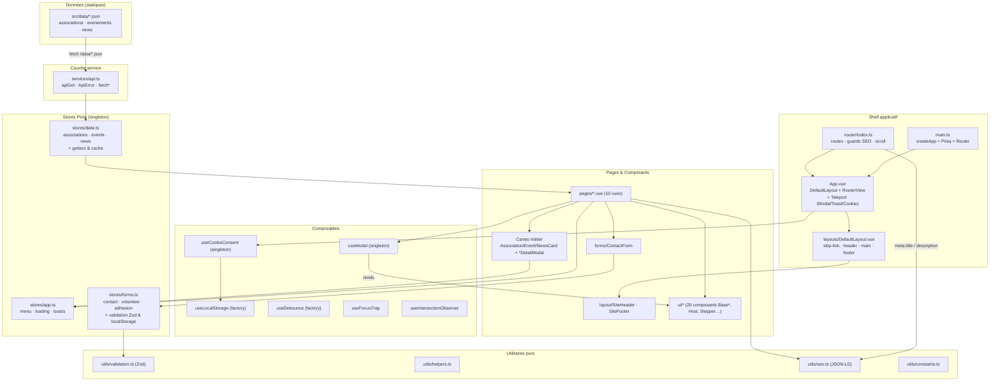
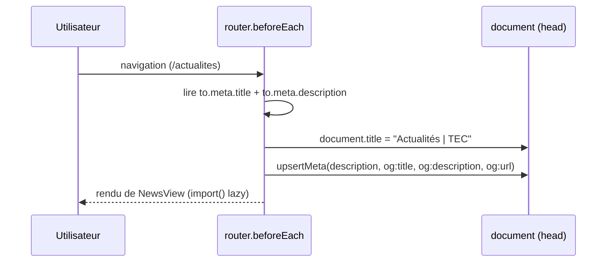

# 🏗️ Architecture — Toulouse Esport Connect (TEC)

> Vue d'ensemble technique de l'application Vue 3 : flux de données, état,
> routage, composables et styles.
> Pour l'installation et les commandes, voir le [`README.md`](./README.md).

---

## 1. Diagramme global



---

## 2. Flux de données

```text
src/data/*.json
   │  fetch('/data/…')         (plugin Vite tecDataAssets : dev middleware + copie dist/data)
   ▼
services/api.ts                ← seule couche HTTP (ApiError, typage strict)
   │  Promise.all([associations, events, news])
   ▼
stores/data.ts                 ← cache : loadAll() no-op si déjà chargé, forceRefresh() force
   │  refs + computed getters (sortedEvents, sortedNews, isLoaded)
   ▼
pages/*.vue                    ← lecture, filtrage local, pagination, synchronisation URL
   │  props
   ▼
components/*                   ← présentation + emits (open, update:modelValue…)
   │
   ├──▶ stores/app.ts          ← showToast() / menu mobile (retour d'information)
   └──▶ stores/forms.ts        ← submitContact / submitVolunteer / submitAdhesion
              │                   (validation Zod → localStorage → reset + success)
              ▼
        localStorage            ← tec_contacts, tec_volunteers, tec_adhesions, brouillons
```

Principes :

1. **Une seule source de vérité pour les données** : `stores/data.ts`. Une page ne
   doit jamais appeler `fetch` directement.
2. **Les composants ne persistent rien** : la persistance passe par les stores ou
   `useLocalStorage`.
3. **Les erreurs ne sont jamais jetées vers l'utilisateur brutement** : `loadAll()`
   capture l'erreur dans `dataStore.error`, les soumissions renvoient `false` avec
   `state.error` lisible.
4. **Format des dates** : `AAAA-MM-JJ` partout (parse sans décalage de fuseau via
   `parseIsoDate`).

---

## 3. State management (Pinia)

Trois stores Setup (`defineStore('id', () => { … })`), instanciés en **singleton**
par Pinia — un seul état partagé pour toute l'application, réactif par `ref` /
`computed` / `reactive`.

| Store | État | Getters | Actions clés | Persistance |
|---|---|---|---|---|
| `app` | `isMobileMenuOpen`, `isLoading`, `toasts` | — | `toggleMobileMenu`, `open/closeMobileMenu`, `setLoading`, `showToast`, `hideToast` | Timers mémoire (`Map`) pour l'auto-masquage |
| `data` | `associations`, `events`, `news`, `loading`, `error` | `sortedEvents`, `sortedNews`, `isLoaded` | `loadAll({force})`, `forceRefresh`, `clear`, `getAssociationBySlug`, `getUpcomingEvents`, `getLatestNews`, `getEventsByCategory`, `searchAssociations` | Cache en mémoire (rechargement conditionnel) |
| `forms` | `contact`, `volunteer`, `adhesionIndiv`, `adhesionAsso` + `*State` (`submitting/success/error`) | — | `submitContact`, `submitVolunteer`, `submitAdhesion(data, kind)`, `reset*` | `localStorage` (tableaux horodatés) |

Règles :

- **Getters** = `computed` (dérivés, jamais dupliqués manuellement).
- **Actions asynchrones** : `Promise<boolean>` pour les formulaires (`true` =
  succès), `Promise<void>` pour le chargement (erreur stockée dans `state.error`).
- **Bornage UI** : la pile de toasts est limitée à 3 entrées, timer nettoyé à la
  suppression.
- **Docstrings TSDoc** : chaque `state`, getter et action est commenté
  (`@param`, `@returns`) — voir [`docs/stores.md`](./docs/stores.md).

---

## 4. Routage (Vue Router 4)

### Historique

```ts
// src/router/index.ts
const useHashHistory = import.meta.env.VITE_HASH_ROUTER === 'true';
history: useHashHistory ? createWebHashHistory(BASE_URL) : createWebHistory(BASE_URL)
```

- **Par défaut** : `createWebHistory` (URL propres `/associations`) → nécessite un
  rewrite SPA côté hébergeur (`/* → /index.html`).
- **Repli** : `VITE_HASH_ROUTER=true` → `createWebHashHistory` (`/#/associations`),
  utilisable sur tout hébergeur statique sans configuration.

### Routes (10)

| Path | `name` | Composant (lazy) | `meta.title` |
|---|---|---|---|
| `/` | `home` | `HomeView` | Accueil |
| `/associations` | `associations` | `AssociationsView` | Associations |
| `/evenements` | `events` | `EventsView` | Événements |
| `/actualites` | `news` | `NewsView` | Actualités |
| `/qui-sommes-nous` | `about` | `AboutView` | Qui sommes-nous ? |
| `/contact` | `contact` | `ContactView` | Contact |
| `/mentions-legales` | `legal` | `LegalView` | Mentions légales |
| `/benevolat` | `volunteer` | `VolunteerView` | Devenir bénévole |
| `/adhesion` | `adhesion` | `AdhesionView` | Adhésion |
| `/:pathMatch(.*)*` | `not-found` | `NotFoundView` | Page introuvable |

Les noms sont exposés par l'enum typé `routeNames` (utilisable dans les liens
programmatiques : `router.push({ name: routeNames.Associations })`).

### Guards & métadonnées



- **`beforeEach`** : applique `title`, `description` et les balises Open Graph
  (`upsertMeta` crée ou met à jour la balise).
- **`scrollBehavior`** : ancre interne → `el`, `top: 96` (offset du header sticky),
  `behavior: smooth` ; sinon `savedPosition` (retour navigateur) ou `top: 0`.
- **Lazy loading** : chaque route est un `() => import('@/pages/…')` → un chunk par page.
- **Préchargement** : `App.vue` injecte des `<link rel="prefetch" as="document">`
  pour `/`, `/associations`, `/evenements`, `/actualites` après le premier rendu.
- **Transition** : `<Transition name="fade" mode="out-in">` autour de `<RouterView>`.

---

## 5. Composables — singleton vs factory

| Composable | Pattern | État | Usage typé |
|---|---|---|---|
| `useModal()` | **Singleton** (refs module) | Partagé : `isOpen`, `content`, `props` | `modal.open(AssociationDetailModal, { association })` — rendu par `<ModalHost />` (Teleport `body`) |
| `useCookieConsent()` | **Singleton** (status persisté) | `status` (`granted/denied/pending`) + computeds | `init()` au montage de `App.vue` ; injecte PostHog seulement si `granted` |
| `useLocalStorage(key, default)` | **Factory** (nouvelle `Ref` par appel) | Isolé par clé | Brouillons, préférences, consentement |
| `useDebounce(source, delay)` | **Factory** | Copie décalée d'une `Ref` | `SearchInput` (300 ms), synchronisation filtres → URL |
| `useFocusTrap(target, opts)` | **Factory** (side-effect) | Piège local (focus mémorisé) | Modale, menu mobile, bandeau cookies |
| `useIntersectionObserver(target, opts)` | **Factory** (side-effect) | `isIntersecting` | Compteurs animés, reveal au scroll |

**Singleton** = l'état vit au niveau module : toutes les appels partagent la même
référence (une seule modale globale, un seul consentement).

**Factory** = chaque appel crée son propre état isolé (autant de brouillons que de
clés `localStorage`).

Tous sont documentés dans [`docs/composables.md`](./docs/composables.md).

---

## 6. Composants

```text
components/
├── ui/                    # 20 pièces génériques, sans métier
│   ├── form/*             # BaseInput, BaseTextarea, BaseSelect, BaseCheckbox,
│   │                      # BaseRadio(Group), BaseDatePicker, BaseFileInput, TagInput
│   ├── BaseButton         # variant/size/loading + rendu <button> | <RouterLink> | <a>
│   ├── ModalHost          # <Teleport body> : focus trap, Escape, ARIA (dialog)
│   ├── ToastHost          # filet de sécurité aria-live="polite" des toasts
│   ├── CookieBanner       # consentement RGPD (role="dialog")
│   ├── CookiePreferencesPanel
│   ├── Accordion          # ouverture unique/multiple, hauteur animée (grid 0fr→1fr)
│   ├── Stepper            # progression multi-étapes + role="status"
│   ├── ImageCarousel      # auto-play, pause au survol/focus/onglet masqué
│   └── TagInput           # combobox + listbox (saisie de tags)
├── layout/                # SiteHeader (nav, menu mobile), SiteFooter (liens, réseaux)
├── forms/ContactForm      # validation + soumission + retours accessibles
├── AssociationCard / EventCard / NewsCard        # cartes cliquables (emit open)
├── AssociationDetailModal / EventDetailModal / NewsDetailModal  # fiches (useModal)
├── CategoryFilter         # radio ou multi-checkbox (v-model / v-model:selected)
├── SearchInput            # champ débouncé
├── Pagination             # fenêtre de pages centrée (v-model)
├── StatsCounter           # compteurs animés (IntersectionObserver)
└── HeroSection            # <h1> + slot "actions"
```

Conventions :

- **Typage** : `interface Props` + `withDefaults(defineProps<Props>(), …)`, et
  `defineEmits<{ … }>()` typé (jamais de tableau de chaînes non typé).
- **`v-model`** : `modelValue` + `update:modelValue` pour tous les champs contrôlés.
- **Accessibilité** : ids auto (`useId`), `aria-describedby` (aide + erreur),
  `role="alert"` sur les messages d'erreur.
- **Docstrings** : chaque composant commence par un bloc `/** … */` décrivant son
  rôle ; les props sont commentées prop par prop — voir [`docs/components.md`](./docs/components.md).

---

## 7. CSS & design system (Tailwind 4)

Plus de `tailwind.config.js` : la configuration vit **dans le CSS**.

```css
/* src/assets/css/main.css */
@import 'tailwindcss' source(none);   /* détection automatique désactivée */
@source '../../';                     /* src/**/*.{vue,ts} */
@source '../../../index.html';        /* classes utilisées dans index.html */
@import './variables.css';            /* variables CSS (glassmorphism, glows) */

@theme {                              /* design tokens → utilités générées */
  --color-brand-red: #e30613;
  --font-bebas: 'Bebas Neue', sans-serif;
  --animate-fade-in: fade-in 0.3s ease-out;
}

@utility btn { … }                    /* patterns réutilisables @apply-ables */
@layer components { .glass-card { … } }
```

| Concept | Emplacement | Rôle |
|---|---|---|
| **`@theme`** | `main.css` | Tokens de marque → `bg-brand-red`, `font-bebas`, `animate-fade-in`… (miroir de `BRAND_COLORS` dans `utils/constants.ts`) |
| **`@source`** | `main.css` | Fichiers scannés (détection explicite, `source(none)` en amont) |
| **`@utility`** | `main.css` | `btn`, `btn-primary`, `btn-outline`, `btn-ghost`, `input-base` |
| **`@layer components`** | `main.css` | `nav-link`, `glass-card`, `glow-*`, `skip-link` |
| **Variables CSS** | `variables.css` | `--glass-*`, `--glow-*` (effets purs, pas de tokens) |
| **Fonts self-hosted** | `assets/fonts/` | `@font-face` avec `font-display: swap` (aucun appel externe) |
| **Transitions Vue** | `main.css` | `.fade-*`, `.mobile-panel-*`, `.slide-fade-*`, `.page-enter-*` |

**Dark mode ready** : l'interface est *dark-first* (`bg-brand-dark`, texte clair),
la palette est définie une seule fois dans `@theme`. L'ajout d'un basculeur clair se
fait sans refonte : déclarer `@custom-variant dark (&:where(.dark, .dark *));`, poser
la classe `dark` sur `<html>` et compléter les tokens — aucune structure de
composant n'est à changer.

PostCSS : `postcss.config.js` charge `@tailwindcss/postcss` (le build Vite compile
le CSS, pas de CLI au runtime).

---

## 8. Performance & sécurité

- **Chunks vendors** : `vite.config.ts` (Vite 8 / Rolldown) découpe
  `vendor-vue`, `vendor-zod`, `vendor-ui` via `advancedChunks.groups`.
- **Sourcemaps + CSS code splitting** activés sur le build.
- **Préchargement** des 4 routes principales (`<link rel="prefetch">`).
- **Données** : 1 seul `Promise.all` au premier écran, cache ensuite en mémoire.
- **CSP-ready** : aucune inline script exécutée, aucun CDN externe (fonts + CSS
  self-hosted), le tracker PostHog est injecté dynamiquement et **uniquement** après
  consentement explicite.
- **XSS** : interpolation Vue (`{{ }}`) partout, `JSON.stringify` pour le JSON-LD,
  pas de `v-html` sur les données externes.

---

## 9. Qualité

| Garde-fou | Outil | Commande |
|---|---|---|
| Types | `vue-tsc` + `tsc` (Node config) | `npm run typecheck` |
| Lint / format | ESLint flat config + Prettier | `npm run lint` |
| Tests unitaires | Vitest (jsdom) | `npm run test:unit` |
| Couverture | V8 — seuils 80/80/70/80 | `npm run test:coverage` |
| E2E | Playwright (installation prête) | *suite à venir* — voir [`docs/deployment.md`](./docs/deployment.md) |

Le lint ignore volontairement le legacy (`js/`, `css/`, `sections/`,
`index.legacy.html`), linté par `eslint.legacy.config.mjs`.
