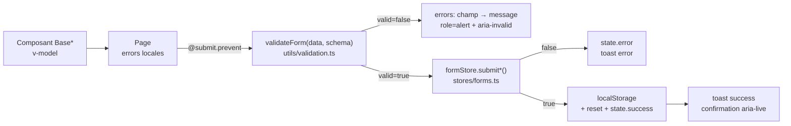

# 📝 Formulaires — validation Zod, soumission, persistance

> Trois formulaires métier : **Contact**, **Devenir bénévole** (4 étapes) et
> **Adhésion** (particulier / structure). Tous suivent le même cycle :
>
> **saisie (composants `Base*`)** → **validation (Zod / locale)** →
> **`useFormStore.submit*()`** → **persistance `localStorage`** →
> **toast + réinitialisation**.

Fichiers clés : [`src/utils/validation.ts`](../src/utils/validation.ts) ·
[`src/stores/forms.ts`](../src/stores/forms.ts) · [`src/types/index.ts`](../src/types/index.ts)

---

## 1. Architecture d'une soumission



### `validateForm()` — helper générique

```ts
function validateForm<T extends z.ZodType>(data: unknown, schema: T): ValidationResult<z.infer<T>>

interface ValidationResult<T> {
  valid: boolean;
  errors: Record<string, string>;   // 1er message par champ (chemins "a.b" joints par ".")
  data?: T;                          // données parsées — seulement si valid === true
}
```

- `safeParse` Zod, **jamais de throw**.
- `flattenIssues()` conserve le **premier** message de chaque chemin de champ.

---

## 2. Primitives Zod réutilisables

| Primitives | Règle | Message |
|---|---|---|
| `requiredString(label, minLength = 1)` | `string().trim().min(minLength)` | « … est requis. » / « … doit contenir au moins N caractère(s). » |
| `optionalString()` | `string().trim()` (vide accepté) | — |
| `emailField(label)` | `z.email().trim().min(1)` | « … invalide. » / « … est requis. » |
| `optionalIsoDate(label)` | regex `^\d{4}-\d{2}-\d{2}$` **ou** `''` | « … doit être une date valide (AAAA-MM-JJ). » |
| `cguField(message)` | `boolean().refine(v => v)` | « Vous devez accepter les conditions d’utilisation. » |

---

## 3. Contact — `/contact`

**UI** : [`ContactForm.vue`](../src/components/forms/ContactForm.vue) ·
**Action** : `formStore.submitContact(data?)`

| Champ | Contrôle |
|---|---|
| `name` | requis (trim) |
| `email` | requis + `@` (validation UI locale) |
| `subject` | requis |
| `message` | requis |

- Validation **locale** (complément des attributs natifs `required` / `type="email"`),
  erreurs révélées champ par champ (`role="alert"`, `aria-describedby`).
- Persistance : tableau horodaté **`tec_contacts`**.
- Retour : message de succès + `appStore.showToast('Message envoyé !', 'success')`.

---

## 4. Devenir bénévole — `/benevolat` (multi-étapes)

**UI** : [`VolunteerView.vue`](../src/pages/VolunteerView.vue) ·
**Schemas** : `volunteerStepSchemas[0…3]` · **Action** : `formStore.submitVolunteer(data?)`

### Étapes (`Stepper`, index 0-based côté composant)

| Étape | Schema | Champs |
|---|---|---|
| 1 — Profil | `volunteerProfileSchema` | `firstName`, `lastName`, `email`, `phone?`, `birthDate?`, `city` |
| 2 — Motivations | `volunteerMotivationsSchema` | `interests[]` (≥ 1), `availability[]` (`jour\|soir\|weekend`, ≥ 1), `motivations?` |
| 3 — Compétences | `volunteerSkillsSchema` | `skills[]`, `languages?`, `hasDrivingLicence`, `hasVehicle`, `pastExperience?` |
| 4 — Validation | `volunteerConsentSchema` | `acceptCgu` (obligatoire) |

`volunteerSchema` = union des 4 (utilisé par `submitVolunteer` à l'envoi final).

### Comportements

- **Validation pas-à-pas** : `validateForm(payloadÉtape, step)` avant de passer à
  l'étape suivante ; les erreurs n'apparaissent qu'après une interaction
  (`interacted`), puis `fieldError(champ)` affiche le message.
- **Navigation arrière** : `@step-click` du `Stepper` → `goToStep(index + 1)`
  (seulement sur les étapes franchies).
- **Brouillon persistant** : `useLocalStorage('tec_volunteer_draft', default)` —
  la saisie survit à un rechargement ou une navigation ; `formData` est la `Ref`
  du brouillon (chaque frappe est écrite).
- **Envoi** : `submit()` → `formStore.submitVolunteer()` → panneau de
  confirmation (`aria-live`) + redirection différée vers l'accueil.
- **Réinitialisation** : le brouillon est vidé (`draft.remove()` + défaut) après
  succès ; l'historique complet est archivé dans **`tec_volunteers`**.

```ts
import { validateForm, volunteerStepSchemas } from '@/utils/validation';

const { valid, errors } = validateForm(stepPayload(step.value), volunteerStepSchemas[step.value - 1]);
if (!valid) { /* mappe errors → fieldError() */ }
```

### Constantes d'UI (exportées par `stores/forms.ts`)

- `VOLUNTEER_INTERESTS` : Événementiel, Communication, Technique, Encadrement, Logistique.
- `VOLUNTEER_AVAILABILITIES` : `{ id: 'jour'|'soir'|'weekend', label }` — **ids alignés
  sur `z.enum(['jour','soir','weekend'])`** (ne pas renommer sans changer le schema).

---

## 5. Adhésion — `/adhesion`

**UI** : [`AdhesionView.vue`](../src/pages/AdhesionView.vue) ·
**Schemas** : `adhesionIndivSchema` / `adhesionAssoSchema` ·
**Action** : `formStore.submitAdhesion(data, kind)` avec `kind: 'indiv' | 'asso'`

### Onglets accessibles

Deux onglets `role="tab"` avec `aria-controls` / `aria-labelledby` croisés
(`adhesion-tab-indiv` ↔ `adhesion-panel-indiv`, idem `asso`) ; le type courant
est dans la ref `kind`.

### Adhésion individuelle (`kind = 'indiv'`)

| Champ | Règle Zod |
|---|---|
| `firstName`, `lastName` | requis |
| `email` | email valide, requis |
| `phone` | facultatif |
| `address` | requis |
| `birthDate` | ISO ou vide |
| `contribution` | `enum('1','5')` — 1 € membre individuel, 5 € membre sympathisant (`CONTRIBUTION_OPTIONS`) |
| `paymentMethod` | `enum('cb','cheque','virement')` — options `PAYMENT_OPTIONS` |
| `acceptCgu` | `true` obligatoire |

### Adhésion structure (`kind = 'asso'`)

Cotisation affichée : **50 € / an — entité morale**.

| Champ | Règle Zod |
|---|---|
| `name` | requis |
| `siret` | regex `^\d{14}$` (exactement 14 chiffres) |
| `repFirstName`, `repLastName` | requis |
| `repEmail` | email valide |
| `address` | requis |
| `description` | requis, **min 20 caractères** |
| `website` | vide **ou** `^https?://\S+$` |
| `discord` | facultatif |
| `games[]` | ≥ 1 élément (`TagInput`) |
| `membersCount` | entier ≥ 1, nullable — saisi en `string` côté UI puis converti |
| `logo` | nom de fichier (upload **stub**, `BaseFileInput`) |
| `acceptCgu` | `true` obligatoire |

- **Préremplissage** : `?asso=<nom>` dans l'URL bascule sur l'onglet structure.
- **Payload nettoyé** : `membersCount` `string → number | null`, `logo` =
  `logoFile.name` si un fichier est sélectionné.
- Persistance : **`tec_adhesions`** avec `{ …data, kind, submittedAt }`.
- Réinitialisation : uniquement le formulaire du type soumis
  (`resetAdhesionIndiv` / `resetAdhesionAsso`).

---

## 6. Persistance `localStorage`

| Clé (`STORAGE_KEYS`) | Contenu | Écrit par |
|---|---|---|
| `tec_cookie_consent` | `'granted' \| 'denied' \| 'pending'` | `useCookieConsent` |
| `tec_contacts` | tableau `{ …ContactFormData, submittedAt }` | `submitContact` |
| `tec_volunteers` | tableau `{ …VolunteerFormData, submittedAt }` | `submitVolunteer` |
| `tec_volunteer_draft` | `VolunteerFormData` (brouillon de saisie) | `useLocalStorage` (VolunteerView) |
| `tec_adhesions` | tableau `{ …data, kind, submittedAt }` | `submitAdhesion` |

Règles :

- `persistToStorage()` **parse défensivement** (une valeur non-tableau est remplacée
  par `[]`) et **lève une erreur métier** si le stockage est indisponible — message
  affiché à l'utilisateur, jamais de crash.
- `submittedAt` est ajouté automatiquement (`new Date().toISOString()`).
- Aucune donnée ne quitte le navigateur : il n'existe pas encore d'API d'envoi.

---

## 7. Bonnes pratiques

1. **Un schema = une source de vérité** : ne jamais dupliquer une règle de
   validation dans l'UI (l'UI peut afficher, le schema décide).
2. **Erreurs** : toujours `errors[champ]` → `BaseInput.error` (qui pose
   `aria-invalid` + `aria-describedby` + `role="alert"`).
3. **Feedback** : succès/échec → `appStore.showToast()` + message inline en
   `aria-live="polite"`.
4. **Réinitialiser** après succès (`reset*` du store), pas manuellement dans la vue.
5. **Nouveaux champs** : mettre à jour `src/types/index.ts` → schema Zod →
   store (`EMPTY_*`) → UI → tests (`tests/stores/forms.test.ts`,
   `tests/utils/validation.test.ts`) → cette documentation.
